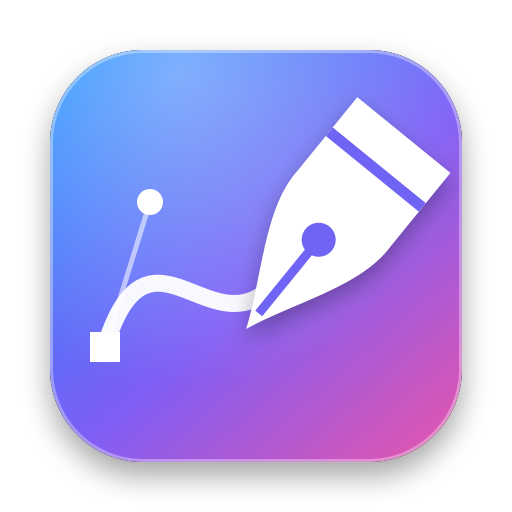

<h1 align="center">قلم</h1>

<b>أداة رسم بالقلم والأشكال مباشرة داخل عارض Final Cut Pro</b>

---

## ما هو «قلم»؟

«قلم» إضافة لبرنامج **Final Cut Pro** تتيح لك الرسم فوق الفيديو مباشرة في العارض: قلم مسارات احترافي كالذي في فيجما وإليستريتر، ورسم حر، وأشكال جاهزة، مع رسم تدريجي متحرك. الواجهة كلها بالعربية، والرسم يتم على كرت الشاشة (Metal) فيبقى سريعًا حتى في دقة 4K و8K.

## المميزات

### أدوات الرسم في العارض
- **شريط أدوات زجاجي عائم** داخل الإطار، يُسحب إلى أي مكان ويُحفظ موضعه، ويُخفى بزر.
- **قلم المسارات:** انقر للنقاط، واسحب للانحناء، و<kbd>Option</kbd> لكسر تماثل المقابض.
- **رسم حر** يتحوّل تلقائيًا إلى منحنيات ناعمة قابلة للتعديل.
- **خط، سهم، مستطيل، دائرة، ممحاة.**
- **إضافة نقطة وحذف نقطة** في أي شكل دون تغيير منحناه.

### التعديل بعد الرسم
- تحريك النقاط والمقابض، وسحب الخط نفسه لثنيه مباشرة.
- إخراج مقبضين من نقطة حادة بـ <kbd>Option</kbd> + سحب.
- **مغنطة الاستقامة:** يظهر دليل أخضر عند الوصول إلى الأفقي أو الرأسي أو 45°.
- النقطة المحددة ومقابضها بلون مميز.
- كل عملية خطوة واحدة في التراجع <kbd>⌘</kbd><kbd>Z</kbd>.

### الألوان والأسلوب
- **التعبئة والحدود منفصلتان** في الشريط، مع لوحة ألوان واسعة وشفافية سريعة.
- **«ألواني»:** احفظ أي لون من المفتش لتستخدمه في كل مشاريعك.
- سماكة، أطراف، خط متقطع، رأس سهم ممتلئ أو مفتوح.
- **توهج وظل** بجودة عالية.

### التنظيم والتحويل (جديد في ٣.٠)
- **أسلوب مستقل لكل شكل:** لكل شكل لونه وسماكته وتعبئته؛ التغيير يُطبَّق على المحدد فقط.
- **تحديد متعدد** بـ <kbd>Shift</kbd> أو بمستطيل تحديد، مع **نسخ ولصق وتكرار**.
- **ترتيب الطبقات:** إحضار للمقدمة، تقديم، تأخير، إرسال للخلف.
- **تكبير وتدوير** بمقابض حول المحدد.
- **الأنماط المحفوظة:** أنماط جاهزة واحفظ أنماطك.
- **تدرّج لوني** خطي أو دائري بلونين وزاوية، و**قطّارة** تلتقط أي لون من الشاشة.
- **نص عربي على المسار** يتبع انحناء الشكل ويظهر حرفًا حرفًا.
- **اختصارات لوحة المفاتيح** للأدوات والأوامر.

### الألوان والنقاط (جديد في ٤.١)
- **عجلة ألوان وشريط سطوع** داخل قائمة الألوان في العارض.
- **حقل كود اللون:** اكتب أو الصق كودًا مثل `FF8800` ثم Enter.
- **مجموعات ألوانك من ماك وفاينل كت** تظهر في القائمة نفسها، مفصولة بخط.
- **أداة «تحويل نقطة»:** نقرة تُظهر مقابض النقطة أو تخفيها، وسحب منها يُخرج مقبضين.

### اللصق من البرامج الأخرى (جديد في ٤.٠)
- **الصق رسمة منسوخة** من Illustrator أو Pixelmator أو غيرهما بـ <kbd>⌘V</kbd> فتصبح أشكالًا قابلة للتعديل، بنقاطها وألوانها وتدرّجاتها.
- شريط أدوات يتكيّف مع الشاشات الصغيرة، ولوحات لا تُقصّ.
- تنبيه واضح إذا كانت الرسمة أكبر مما يحفظه فاينل كت.

### الحركة
- **رسم تدريجي** تلقائي أو بالإطارات المفتاحية، الأشكال واحدًا تلو الآخر أو معًا.
- **توقيت خاص لكل شكل**، وظهور التعبئة بالتلاشي أو المسح.
- منحنيات سرعة متعددة، وخروج بالتلاشي أو بالمسح العكسي.

### التحديثات
- يتحقق التطبيق تلقائيًا من وجود إصدار جديد هنا ويعرض تنزيله.

## المتطلبات

- macOS 14 (Sonoma) أو أحدث.
- Final Cut Pro (إصدار حديث يدعم FxPlug 4).
- جهاز Mac بمعالج Apple Silicon أو Intel.

## التثبيت

1. نزّل أحدث ملف `Qalam-x.x.x.dmg` من صفحة [الإصدارات](../../releases/latest).
2. افتح الملف واسحب **«قلم»** إلى مجلد **Applications**.
3. شغّل **«قلم»** مرة واحدة؛ فهو يسجّل الإضافة ويثبّت قالبها تلقائيًا.
4. أغلق Final Cut Pro تمامًا ثم افتحه.
5. ستجد **«قلم الرسم»** في متصفح **المولّدات** ← فئة **«قلم»**.

> **تنبيه أمان من macOS:** إن ظهرت رسالة أن التطبيق من مطوّر غير معروف، فانقر على التطبيق بزر الفأرة الأيمن ← **فتح** ← **فتح**. أو من **إعدادات النظام ← الخصوصية والأمان** اضغط **«فتح على أي حال»**.

## طريقة الاستخدام

1. اسحب **«قلم الرسم»** فوق مقطعك في الخط الزمني.
2. حدّده، فيظهر شريط الأدوات في أسفل العارض.
3. اختر أداة وارسم مباشرة على الصورة.
4. اضبط الألوان والسماكة والحركة من الشريط أو من **المفتش**.

### اختصارات مفيدة

| الاختصار | الوظيفة |
|---|---|
| <kbd>Option</kbd> + سحب المقبض | كسر التماثل وتحريك المقبض وحده |
| <kbd>Option</kbd> + سحب من نقطة | إخراج مقبضين منها |
| <kbd>Option</kbd> + نقر على نقطة | تبديل بين نقطة حادة وناعمة |
| <kbd>Shift</kbd> | تقييد الزوايا بمضاعفات 45° |
| <kbd>Return</kbd> أو <kbd>Esc</kbd> | إنهاء المسار المفتوح |
| <kbd>Delete</kbd> | حذف النقطة أو الشكل المحدد |
| <kbd>⌘</kbd><kbd>Z</kbd> | تراجع |
| <kbd>V</kbd> <kbd>P</kbd> <kbd>B</kbd> <kbd>L</kbd> <kbd>A</kbd> <kbd>R</kbd> <kbd>E</kbd> <kbd>X</kbd> | تحديد، قلم، رسم حر، خط، سهم، مستطيل، دائرة، ممحاة |
| <kbd>⌘</kbd><kbd>C</kbd> / <kbd>⌘</kbd><kbd>V</kbd> / <kbd>⌘</kbd><kbd>D</kbd> | نسخ / لصق / تكرار |
| <kbd>⌘</kbd><kbd>]</kbd> / <kbd>⌘</kbd><kbd>[</kbd> | تقديم / تأخير طبقة |

## الإزالة

افتح تطبيق **«قلم»** واضغط **«إزالة «قلم» من الجهاز»** أسفل النافذة (أو من قائمة التطبيق). تُنقل كل ملفاته إلى سلة المهملات: التطبيق والإضافة، وقالب «قلم الرسم»، والإعدادات و«ألواني». أغلق Final Cut Pro قبلها.

## الترخيص

«قلم» مجاني للاستخدام الشخصي والتجاري. الكود المصدري غير منشور. لا يجوز بيع البرنامج أو إعادة توزيعه معدّلًا دون إذن.

## الدعم

لأي مشكلة أو اقتراح افتح [بلاغًا جديدًا](../../issues/new).

